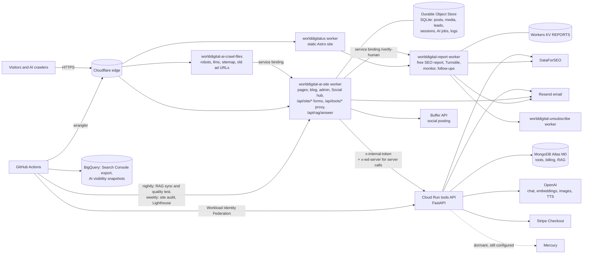

# System architecture (verified 2026-11-04)

Everything here was read from the source code and config at commit `b6f8fbf` (worlddigital-ai) and `577ec82`
(worlddigital-us), or observed on the live sites. Anything that could not be checked is marked **UNVERIFIED**.

## Repositories

| Repo | Tracked files | Contents |
|---|---|---|
| `WorldDigitalai/worlddigital-ai` (private) | 586 (410 in `archive/`) | Company site worker, crawl-file worker, Python tools API, tools, docs, archived Next.js app |
| `WorldDigitalai/worlddigital-us` (private) | ~120 | Astro site, free-report worker (Python), unsubscribe worker (Python), tools |

## Components

| Component | Tech | Runs on | Source | Deploy |
|---|---|---|---|---|
| worlddigital.ai site, blog, blog editor, admin, Social hub | JavaScript Cloudflare Worker (`worlddigital-ai-site`) + SQLite Durable Object `Store` | Cloudflare, route `worlddigital.ai/*`, hourly cron `23 * * * *` | `workers/ai-site/` (≈3,000 lines) | `deploy-ai-site.yml` on push to `main` |
| Crawl-file forwarder | Cloudflare Worker (`worlddigital-ai-crawl-files`) | Routes for robots/llms/sitemap and retired ad pages, forwards to site worker | `workers/ai-crawl-files/` | `deploy-ai-crawl-files.yml` |
| Tools API | Python 3.13, FastAPI, uvicorn, pymongo, httpx | Google Cloud Run `worlddigital-ai-api` (us-central1, project `cs-poc-0zqkvyxapah85tnxz2byzqa`), 0–3 instances, 1 GiB, 300 s timeout | `backend/` (≈3,800 lines in `app/`) | `deploy-backend.yml` (tests, then deploy from source) |
| worlddigital.us site | Astro 5.18.2 + Tailwind 4, static | Cloudflare Worker `worlddigitalus` (static assets) | `worlddigital-us/web/` | `deploy-web.yml` (build, link check, responsive check, IndexNow) |
| Free SEO report API, Turnstile verifier, nightly monitor, follow-ups | Python Cloudflare Worker `worlddigital-report` + KV `REPORTS`, cron every 15 min | Cloudflare | `worlddigital-us/workers/report/` | `deploy-report.yml` |
| Unsubscribe API | Python Cloudflare Worker `worlddigital-unsubscribe` | Cloudflare | `worlddigital-us/workers/unsubscribe/` | `deploy-unsubscribe.yml` |
| Database | MongoDB Atlas **M0 free**, MongoDB 8.0.36, GCP central US, cluster `worlddigital-ai`, db `worlddigital_ai`, 14 collections, about 10 MB | Atlas | – | – |
| Old customer app (Next.js + Express) | archived | not deployed | `archive/nextjs-app/` | – |

## How they connect

## Data stores

| Store | What it holds | Backups |
|---|---|---|
| Durable Object `Store` (SQLite, Cloudflare) | Blog posts, media, form leads, admin sessions and login tokens, AI jobs, Autopilot settings, logs | Cloudflare point-in-time recovery for SQLite DOs (30 days) is a platform feature. Its use here is **UNVERIFIED**, and there's no export job |
| MongoDB Atlas M0 | `tool_jobs`, `tool_cache`, `tool_paid`, `tool_limits`, `tool_free_used`, `tool_audit`, `billing_*`, `rag_*` | **None** (M0 has no backups) |
| Workers KV `REPORTS` | Free-report results, follow-up queue, monitor results | None beyond KV durability |
| BigQuery | Search Console bulk export, AI visibility snapshots | Managed by Google |

## Authentication

| Surface | Method |
|---|---|
| Admin / blog editor (`/blog-admin`) | Email magic link (20 min, single use), Turnstile on the request, session cookie `__Host-wd_editor` (HttpOnly, Secure, SameSite=Lax, 7 days), CSRF HMAC token on every change, allow-list `ADMIN_EMAILS` (1 address) |
| Worker → backend | Shared `x-internal-token`, compared in constant time, fails closed if unset. Billing additionally needs `x-wd-server: 1` (added today) |
| GitHub → Google Cloud | Workload Identity Federation (no stored key) |
| GitHub → Cloudflare | `CLOUDFLARE_API_TOKEN` secret |
| Report worker admin | `X-Research-Key` (SHA-256 compared). Nightly check posts are verified with a GitHub OIDC token |
| Customers | **No customer accounts exist.** `/login`, `/signup`, `/dashboard` and `/onboarding` show "Our customer portal is being rebuilt" |

## Scheduled jobs (verified in config)

| Job | Schedule | Does |
|---|---|---|
| Site worker cron | hourly :23 | Scheduled posts, Autopilot, Buffer sharing, search pings |
| `rag-index.yml` | daily 09:37 UTC | Knowledge-base sync and 23-question quality test |
| `site-audit.yml` | weekly + manual | Crawl both sites, deep SEO check, Search Console export, posts to issue #1 |
| `lighthouse-ai.yml` | on push + schedule | Lighthouse on main .ai pages |
| `billing-daily.yml` | paused (manual only) | Mercury renewals |
| Report worker cron (.us) | every 15 min | Follow-up emails; the 10 pm Chicago tick runs the nightly site check and emails it |
| `nightly-responsive.yml` (.us) | nightly | 9 screen sizes on the live site |
| `ai-visibility-snapshot.yml` (.us) | scheduled | AI-answer visibility data to BigQuery |
| `anthropic-wif-test.yml` (both repos) | every push | Test of GitHub → Anthropic token exchange (no production purpose) |

## Not accessible during this audit (UNVERIFIED)

- Google Cloud console: IAM bindings, Secret Manager versions, logs, Monitoring alerts, billing account, budgets. The workspace can only reach Cloud Run through GitHub Actions.
- Cloudflare dashboard: zone settings, WAF rules, the `/5cex/` first-party script source, plan, analytics.
- GitHub repository secrets (the API path is blocked by the proxy) and Actions logs (only annotations are readable).
- Stripe, OpenAI and DataForSEO dashboards (spend limits, webhook settings).
