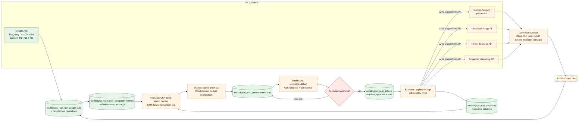

# WorldDigital.ai Platform Architecture (technical audit + target)

**Purpose.** A technical audit of worlddigital.ai, and the target architecture for its Intelligence capabilities (Advertising, Creative, SEO/AI-search, Business Intelligence, Autonomous Marketing).
**Scope.** Repository `WorldDigitalai/worlddigital-ai` at commit `993c158` (2026-10-28), the live site, and the target platform.
**Dependencies.** [Product Architecture](WORLDDIGITAL_PRODUCT_ARCHITECTURE.md), [Machine Learning Architecture](../machine-learning/WORLDDIGITAL_MACHINE_LEARNING_ARCHITECTURE.md), [Customer Data Isolation](../security/WORLDDIGITAL_CUSTOMER_DATA_ISOLATION.md).
**Status.** §1–§3 EXISTING; §4–§5 PROPOSED.

## 1. Site Worker (`workers/ai-site`): EXISTING

| Item | Finding |
|---|---|
| Runtime | Cloudflare Worker `worlddigital-ai-site`, JavaScript ES modules, compatibility date 2026-10-01, observability on |
| Routing | `worlddigital.ai/*`; `www` and `workers.dev` treated as preview (noindex) |
| Pages | 24 HTML page templates in `src/pages/`, page metadata and JSON-LD in `src/pages.js`, shared layout in `src/layout.js` |
| Blog | Markdown seeds in `content/blog/`, editable through `/blog-admin` and stored in the Durable Object |
| Storage | Durable Object `Store` (SQLite): `posts`, `redirects`, `media` (image blobs), `login_tokens`, `sessions`, `leads`, `kv`, `audit` |
| Editor auth | One-time email link (Resend) for `ADMIN_EMAILS` only, Turnstile, hashed tokens, session table, rate limit per hour |
| Tools proxy | `/api/tools/*` forwarded to Cloud Run with `X-Internal-Token` and the visitor IP |
| Retired app paths | `/login`, `/dashboard`, `/api/*`, … show a "portal being rebuilt" page or a 404. `LEGACY_APP=1` would restore passthrough |
| Security headers | HSTS (1 year, subdomains), `nosniff`, `SAMEORIGIN`, referrer policy, `security.txt` |
| Other | Markdown responses for AI agents (`wantsMarkdown`), IndexNow pings, hourly cron, Social Hub built nightly from Buffer data |
| Tests | `node --test` (markdown, tools) |

## 2. Tools API (`backend/`): EXISTING

| Item | Finding |
|---|---|
| Runtime | Python 3.13, FastAPI + Uvicorn, Docker, Cloud Run `worlddigital-ai-api` us-central1, `--allow-unauthenticated`, min 0 / max 3 instances, 512 MiB, 120 s timeout |
| Endpoints | `POST /api/tools/keywords/preview`, `POST /api/tools/content/preview`, `GET /api/tools/job`, `POST /api/tools/checkout`, `GET /api/tools/order`, `GET /api/tools/download`, `GET /api/tools/health` |
| Access control | Fail-closed shared token (`hmac.compare_digest`); 6 previews per IP per day; 24h cache of identical requests; locked items never sent to the browser (only their lengths) |
| AI | OpenAI chat completions in JSON mode; default `gpt-5.4-mini`, with automatic fallback through a model list if the project lacks access |
| Data | MongoDB Atlas `worlddigital_ai`: `tool_jobs`, `tool_cache`, `tool_paid`, `tool_limits` with TTL (previews 30 days, paid orders 1 year) |
| Payments | Stripe Checkout (one-time, automatic tax, inclusive), verified server-side on return |
| Exports | PDF (reportlab), XLSX (openpyxl), DOCX (python-docx) |
| Secrets | Secret Manager: `MONGODB_URI` (pinned v5), `OPENAI_API_KEY` (pinned v2), `DATAFORSEO_*`, `STRIPE_SECRET_KEY`, `RESEND_API_KEY`, `INTERNAL_TOKEN`. **`TOOLS_API_TOKEN` and `GH_RESEND_API_KEY` are passed as plain env vars from GitHub secrets** |
| Tests | pytest with mongomock and respx (no network) |

## 3. Archived app (`archive/nextjs-app/`): not deployed

Next.js 16 frontend, a Vite app, and an Express 5 API. The API includes JWT auth, bcrypt, Drizzle and MongoDB, S3/GCS storage, SendGrid/Resend, and **ad-platform clients for Google Ads (MCC + refresh token), Meta Marketing API v19, TikTok Business API v1.3 and Snapchat**, plus social publishers for LinkedIn, X, YouTube, Meta and TikTok. Its Google Ads client creates **draft** campaigns only ("user confirmation required").
**Value:** reference code for the PROPOSED connectors. **Do not redeploy it as is.** Meta v19 is outdated, and its auth and tenancy model predates this design.

## 4. Target Intelligence capabilities: PROPOSED

### Diagram 3: Advertising Intelligence workflow

<!-- MERMAID:WORLDDIGITAL_ADVERTISING_INTELLIGENCE.mmd -->

<!-- /MERMAID -->

**How it flows.** Each tenant connects ad accounts with OAuth. Connector jobs pull daily data and publish to Pub/Sub. Raw payloads land in `worlddigital_raw` (that table, with `pubsub_message_id`, already exists). Normalization writes the unified `worlddigital_core.daily_campaign_metrics`. Features and models produce rows in `worlddigital_ai.ai_recommendations` with a rationale and a confidence score. The customer approves or edits each recommendation in the dashboard. Approved items become `ai_actions` (`requires_approval = true`), the executor applies them within policy limits, and the measured result goes to `ai_decisions`. That outcome feeds learning. Google Ads data for WorldDigital's own account already arrives through the BigQuery Data Transfer.

| Capability | First version (no training data needed) | Later version (needs data gates) |
|---|---|---|
| Inefficient spend | Rules: spend with 0 conversions over N days, CPA > 2× account median, search terms with spend and no conversions | Anomaly model on spend vs conversions |
| Budget recommendations | Shift budget toward campaigns with lower marginal CPA (pacing math) | Response-curve model per campaign |
| Performance prediction | BigQuery ML `ARIMA_PLUS` on daily clicks/conversions | Boosted trees with seasonality and creative features |
| Audience evaluation | Segment tables (age, gender, geo, device) with significance tests | Uplift-style models |
| Bidding/targeting advice | LLM explains the rule findings in plain language | Learned policy, still approval-gated |

### Creative, SEO/AI-search and Business Intelligence

| Area | First version | Detail |
|---|---|---|
| Creative Intelligence | Vision API labels + LLM critique against platform specs; library of the tenant's own top creatives | [Computer Vision](../deep-learning/WORLDDIGITAL_COMPUTER_VISION.md) |
| SEO & AI-search | Join Search Console, GA4, technical audit and AI-visibility tables; opportunity scoring (impressions high, CTR low, position 5–20); GEO/AEO gaps where the brand isn't cited | [Predictive Analytics](../machine-learning/WORLDDIGITAL_PREDICTIVE_ANALYTICS.md) |
| Business Intelligence | Lead and conversion forecasts, CAC, ROAS, monthly LLM-written report stored in `worlddigital_ai.ai_reports` | [Predictive Analytics](../machine-learning/WORLDDIGITAL_PREDICTIVE_ANALYTICS.md) |
| Autonomous Marketing | Monitoring agent that detects and recommends; execution only after approval | [AI Strategy](../artificial-intelligence/WORLDDIGITAL_AI_STRATEGY.md#agents-and-safeguards) |

## 5. Findings and recommendations

| # | Finding | Severity | Recommendation |
|---|---|---|---|
| AI-1 | Two secrets passed as plain Cloud Run env vars | Medium | Move `TOOLS_API_TOKEN` and the Resend key to Secret Manager references |
| AI-2 | No customer identity or tenancy system | Blocking for the platform | Build on Cloud SQL with row-level security ([Isolation](../security/WORLDDIGITAL_CUSTOMER_DATA_ISOLATION.md)) |
| AI-3 | Secret versions are pinned (`:5`, `:2`) in the workflow | Low | Fine for safety; document the rotation steps |
| AI-4 | OpenAI is the only LLM provider and the model names are hard-coded | Medium | Add an LLM gateway module with provider and model config, evaluation tests and cost logging |
| AI-5 | `worlddigital-ai-crawl-files` is marked for retirement | Low | Retire once the site Worker owns those routes (it already serves them) |
| AI-6 | Tool usage and purchases aren't in BigQuery | Medium | Emit anonymized tool events (`tool_preview`, `tool_paid`) to BigQuery for product analytics |

## Related
[Master](../WORLDDIGITAL_MASTER_ARCHITECTURE.md) · [External Integrations](../integrations/WORLDDIGITAL_EXTERNAL_INTEGRATIONS.md) · [API Architecture](../integrations/WORLDDIGITAL_API_ARCHITECTURE.md)
