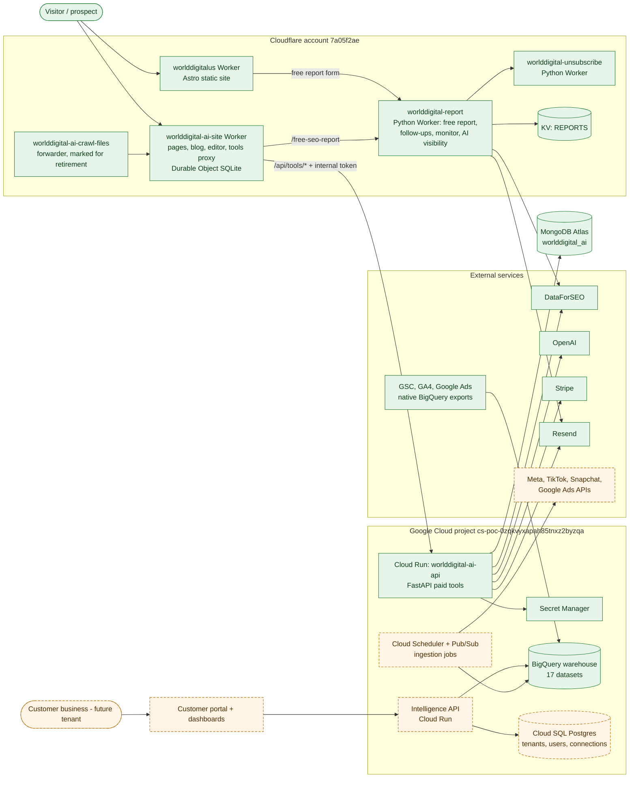

# WorldDigital Product Architecture

**Purpose.** Defines what each website is for, which capabilities belong where, and which services both share, so nothing is built twice.
**Scope.** Product boundaries for worlddigital.ai, worlddigital.us and the shared Intelligence Engine.
**Dependencies.** [Master Architecture](../WORLDDIGITAL_MASTER_ARCHITECTURE.md), [AI Platform Architecture](WORLDDIGITAL_AI_PLATFORM_ARCHITECTURE.md), [WorldDigital.us Architecture](WORLDDIGITAL_US_ARCHITECTURE.md).
**Status.** Current boundaries EXISTING; target split PROPOSED.

## Diagram 1: Overall ecosystem

<!-- MERMAID:WORLDDIGITAL_ECOSYSTEM_MAP.mmd -->

<!-- /MERMAID -->

**How to read it.** Visitors reach either site at the Cloudflare edge. The worlddigital.us form and the worlddigital.ai `/free-seo-report` page both call the **same** `worlddigital-report` Worker. That makes it the first shared service already in production. Paid tools go through the ai-site Worker, which adds an internal token, to the Cloud Run API, which uses MongoDB, DataForSEO, OpenAI, Stripe and Resend. Google's managed exports feed BigQuery independently of the apps. The orange dashed boxes (customer portal, Intelligence API, Cloud SQL, ingestion jobs, ad-platform APIs) are the proposed Intelligence Engine.

| Component | What it does |
|---|---|
| worlddigital-ai-site | Renders pages, blog and blog editor; proxies `/api/tools/*`; owns robots, sitemap and llms files; hourly cron |
| worlddigital-ai-crawl-files | Old route-level forwarder for crawler files and retired social pages; its config says to retire it |
| worlddigitalus | Serves the static Astro build |
| worlddigital-report | Free report, Turnstile check, lead emails, 24h follow-ups, nightly monitor, weekly AI-visibility run, private keyword research |
| worlddigital-unsubscribe | One-click unsubscribe for report emails |
| worlddigital-ai-api | Keyword research and content-pack previews, Stripe checkout, downloads |
| BigQuery | Analytical warehouse for both sites |

## Product split

| Capability | worlddigital.ai (platform) | worlddigital.us (front door) | Shared Intelligence Engine |
|---|---|---|---|
| Free SEO & AI-visibility report | Entry page | Primary lead magnet | Report service (EXISTING `worlddigital-report`) |
| Keyword research, content packs | Self-serve paid tools (EXISTING) | Links to .ai (EXISTING) | Keyword + LLM services |
| Managed SEO/AEO/GEO plan ($199.99/mo) | Marketing page | Pricing + Stripe subscription (EXISTING) | – |
| Customer portal and dashboards | Yes (PROPOSED, rebuild) | Link only | Intelligence API |
| Advertising Intelligence | Yes (PROPOSED) | – | Connectors, models, recommendations |
| Creative Intelligence | Yes (PROPOSED) | – | Vision + LLM services |
| SEO and AI-search Intelligence | Yes (PROPOSED, deeper) | Snapshot in free report | Search + AI-visibility data |
| Business Intelligence reports | Yes (PROPOSED) | Sample report as proof | Forecasting, reporting |
| Local SEO / GBP content, founder brand | – | Yes (EXISTING) | – |
| EHR/EMR integration offering | Service page (EXISTING) | Service page (EXISTING) | Separate PHI project, later (PROPOSED) |

## Principles

1. **One service per capability.** If both sites need it, it lives in the shared engine and both call it (the report Worker already works this way).
2. **worlddigital.us stays light.** A static site with no customer data. Anything that needs an account lives on worlddigital.ai.
3. **The platform owns accounts.** Sign-in, tenants, billing for subscriptions, connected ad accounts and approvals all live behind worlddigital.ai.
4. **Healthcare is a separate product surface.** No PHI enters the marketing stack. See [Security Architecture](../security/WORLDDIGITAL_SECURITY_ARCHITECTURE.md#healthcare-and-phi).

## Risks

- Two Stripe flows exist: one-time Checkout in the API, and the subscription via Stripe-hosted checkout on .us. Neither writes purchases to BigQuery. Purchases are tracked client-side only (see [Data Governance](../data-infrastructure/WORLDDIGITAL_DATA_GOVERNANCE.md)).
- Brand overlap between the two domains. See the [inventory](../WORLDDIGITAL_BRAND_AND_PROJECT_INVENTORY.md#8-duplicates-and-naming-conflicts).

## Related
[Master](../WORLDDIGITAL_MASTER_ARCHITECTURE.md) · [AI Strategy](../artificial-intelligence/WORLDDIGITAL_AI_STRATEGY.md) · [Roadmap](../development-roadmap/WORLDDIGITAL_MASTER_ROADMAP.md)
