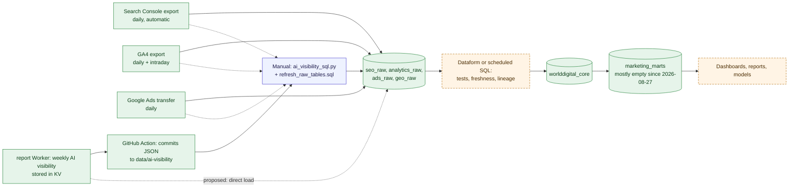

# WorldDigital Data Pipelines

**Purpose.** How data moves into and through the warehouse today, and the target automated pipeline.
**Scope.** Collection, validation, normalization, loading and scheduling.
**Dependencies.** [Data Architecture](WORLDDIGITAL_DATA_ARCHITECTURE.md), [Google Cloud](../google-cloud/WORLDDIGITAL_GOOGLE_CLOUD_ARCHITECTURE.md).
**Status.** Managed exports EXISTING; custom loaders IN PROGRESS (manual); scheduling PROPOSED.

## Diagram 7: Data pipeline

<!-- MERMAID:WORLDDIGITAL_DATA_PIPELINE.mmd -->

<!-- /MERMAID -->

**Today.** Three Google-managed feeds land automatically each day: the Search Console bulk export (both sites), the GA4 export (both properties) and the Google Ads Data Transfer. BigQuery job history confirms that only these Google service accounts write to the warehouse. The weekly AI-visibility run is stored in Workers KV, and a GitHub Action commits it as JSON. Loading it into `geo_raw`, and refreshing `seo_raw` / `analytics_raw` / `ads_raw.google_ads_daily`, is done **by hand** (`tools/bigquery/*` in worlddigital-us). The last run was 2026-10-27. `marketing_marts` hasn't been refreshed since 2026-08-27.

## Target pipeline (the 9 steps from the brief)

| # | Step | Implementation | Status |
|---|---|---|---|
| 1 | Collect authorized data | Managed exports; Cloud Run job connectors per platform and tenant, using OAuth tokens from Secret Manager | Exports EXISTING; connectors PROPOSED |
| 2 | Validate and normalize | Dataform staging models + assertions (not null, unique keys, accepted values, freshness < 36h) | PROPOSED |
| 3 | Protect sensitive data | Drop raw emails and IPs before staging; hash with a tenant-scoped salt when a join key is needed | PROPOSED |
| 4 | Store structured + unstructured | BigQuery (structured); Cloud Storage `gs://…/tenant_id/…` (creatives, pages, PDFs) | PROPOSED |
| 5 | Prepare training datasets | Feature views → dated Parquet snapshots | PROPOSED |
| 6 | Train and evaluate | BigQuery ML scripts in Dataform or Cloud Run jobs | PROPOSED |
| 7 | Deploy validated models | Registry entry flips the "active" pointer; batch scoring reads it | PROPOSED |
| 8 | Monitor | Scheduled drift and accuracy SQL → Cloud Monitoring alerts | PROPOSED |
| 9 | Retrain when justified | Triggered by monitor thresholds, not by a timer | PROPOSED |

## First automation step (smallest useful change)
1. Port `refresh_raw_tables.sql` into a Dataform repository (or a BigQuery scheduled query) to run daily at 06:00 Chicago. Cost: effectively $0 at current volumes.
2. Replace the "commit JSON to git → run Python by hand" path with the report Worker writing the AI-visibility run straight to BigQuery (streaming insert through a service account key in Worker secrets, or posting to a small Cloud Run loader). Keep the git snapshot as a backup.
3. Add freshness assertions and include their status in the existing 10 pm monitor email.

## Ingestion pattern for tenant connectors
`Cloud Scheduler (per platform, daily)` → `Pub/Sub ingest.requests` (one message per tenant × account) → `Cloud Run job connector` (fetch with backoff, respect API quotas) → write raw JSON to `worlddigital_raw.raw_<platform>` with `ingestion_id` and `pubsub_message_id` → log to `worlddigital_audit.data_sync_events` → Dataform normalizes to `worlddigital_core`. Idempotency: `(tenant_id, platform, resource_type, external_id, date)` is the merge key.

## Related
[Feature Engineering](WORLDDIGITAL_FEATURE_ENGINEERING.md) · [Monitoring](../reliability/WORLDDIGITAL_MONITORING_AND_OBSERVABILITY.md)
