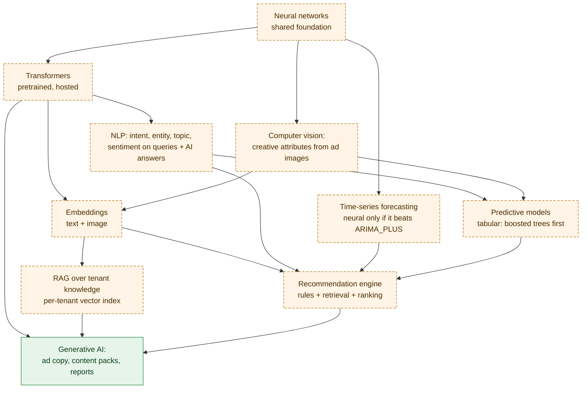

# WorldDigital Deep Learning Architecture

**Purpose.** Where neural networks fit, which are consumed pretrained and which might ever be trained, and the benchmark rule that decides.
**Scope.** NLP, transformers, computer vision, time series, recommendations, generative and multimodal AI.
**Dependencies.** [ML Architecture](../machine-learning/WORLDDIGITAL_MACHINE_LEARNING_ARCHITECTURE.md), [Technology Stack](../architecture/WORLDDIGITAL_TECHNOLOGY_STACK.md).
**Status.** Generative AI through the OpenAI API EXISTING; everything else PROPOSED.

## Diagram 4: Deep learning components

<!-- MERMAID:WORLDDIGITAL_DEEP_LEARNING_ARCHITECTURE.mmd -->

<!-- /MERMAID -->

**How to read it.** Neural networks are the shared foundation. Transformers (consumed as hosted, pretrained models) power NLP, embeddings and generation. Computer vision turns creatives into attributes and image embeddings. Embeddings feed retrieval (RAG) and recommendations. NLP and vision outputs become *features* for ordinary tabular predictive models. Recommendations and RAG ground what the generative layer writes.

| Component | Use at WorldDigital | Build or buy | Detail |
|---|---|---|---|
| Transformers / LLMs | Content, explanations, reports, classification | Buy (API) | [Generative AI](WORLDDIGITAL_GENERATIVE_AI.md) |
| NLP | Query intent, topic clustering, AI-answer entity and sentiment extraction | Buy first; fine-tune small model later | [NLP and Transformers](WORLDDIGITAL_NLP_AND_TRANSFORMERS.md) |
| Embeddings | RAG, semantic keyword clustering, creative similarity | Buy (API) | [NLP and Transformers](WORLDDIGITAL_NLP_AND_TRANSFORMERS.md) |
| Computer vision | Creative attributes, compliance checks | Buy (Vision API, multimodal LLM) | [Computer Vision](WORLDDIGITAL_COMPUTER_VISION.md) |
| Time-series DL | Forecasting | Only if it beats `ARIMA_PLUS` | below |
| Recommendation DL | Ranking | Not before the revisit trigger | [Recommendation Engine](../machine-learning/WORLDDIGITAL_RECOMMENDATION_ENGINE.md) |
| Multimodal | Ad image + copy + landing page judged together | Buy (multimodal LLM) | [Computer Vision](WORLDDIGITAL_COMPUTER_VISION.md) |

## Benchmark rule
A deep model replaces a classical one only when, on the same held-out data, it improves the primary metric by ≥ 10%, costs less than the value of that improvement, and can be explained to the customer. Time-series example: a neural forecaster (e.g. a pretrained time-series foundation model) is compared against seasonal naïve and `ARIMA_PLUS` across all tenants' series. The result is recorded in the model card.

## Framework choice
PyTorch + Hugging Face for any in-house training; Vertex AI custom training jobs on demand (GPU only for that job); no always-on GPU. TensorFlow isn't needed, because no existing code depends on it.

## Related
[Master](../WORLDDIGITAL_MASTER_ARCHITECTURE.md) · [Cost Analysis](../financial-planning/WORLDDIGITAL_COST_ANALYSIS.md)
