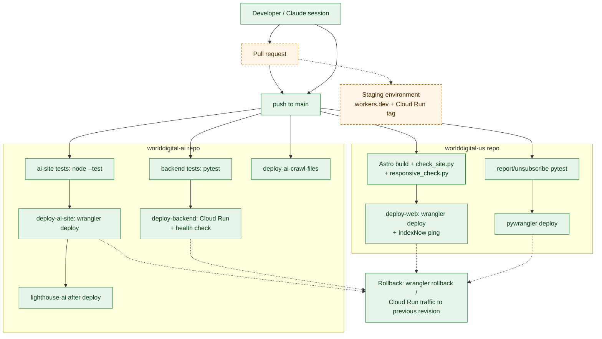

# WorldDigital Deployment Architecture

**Purpose.** How code reaches production in both repos, how to roll back, and what to add.
**Scope.** GitHub Actions, Cloudflare, Cloud Run.
**Dependencies.** [Testing Strategy](../testing/WORLDDIGITAL_TESTING_STRATEGY.md).
**Status.** EXISTING unless marked.

## Diagram 8: Deployment workflow

<!-- MERMAID:WORLDDIGITAL_DEPLOYMENT_WORKFLOW.mmd -->

<!-- /MERMAID -->

**How it works.** A push to `main` triggers the workflow for the changed path only. In worlddigital-ai, `workers/ai-site/**` → tests → `wrangler deploy` → Lighthouse; `backend/**` → pytest → Cloud Run deploy → health check; `workers/ai-crawl-files/**` → deploy. In worlddigital-us, `web/**` → Astro build → safety and responsive gates → deploy → IndexNow; `workers/report|unsubscribe/**` → pytest → `pywrangler deploy`. **Docs-only changes trigger no deploys.** (Only `anthropic-wif-test.yml`, which runs on every push and changes nothing.)

## Rollback (EXISTING capability)
| Target | How |
|---|---|
| Cloudflare Worker | `wrangler rollback` (or the dashboard "Deployments" tab); ai-site: comment out `routes` and redeploy, as its config documents |
| Cloud Run | Route 100% of traffic to the previous revision (`gcloud run services update-traffic`) |
| Data | BigQuery time travel (7 days) |

## Gaps → PROPOSED
1. **Pull-request flow for production:** pushes go straight to `main` today. Use PRs (tests already run on PRs for the backend and ai-site). Branch protection that requires green checks needs GitHub Team or Pro, because the organization is on the free plan, which doesn't offer it for private repositories (verified 2026-11-02).
2. **Automatic rollback on the tools API (IN PROGRESS, in the Phase 1 hardening PR):** the backend deploy remembers the serving revision, sends traffic to the new one, checks `/api/tools/health` with the site token (token match + email key configured), and returns traffic to the previous revision if the check fails.
3. **Staging:** Cloud Run tagged revision (`--tag=staging --no-traffic`) + Worker preview versions for risky changes.
4. **Cloud Run `--min-instances=0`** causes cold starts (a few seconds) on the first tool preview; acceptable now. Use `1` only if conversion data shows drop-off.
5. **Dependency pinning in the Dockerfile:** it re-lists packages instead of using `uv.lock`. Install from the lockfile for reproducible builds.
6. **Infrastructure as code:** capture GCP resources (projects, IAM, Scheduler, Pub/Sub, SQL) in Terraform before Phase 2 resources multiply.

## Related
[Google Cloud](WORLDDIGITAL_GOOGLE_CLOUD_ARCHITECTURE.md) · [Backup and DR](../reliability/WORLDDIGITAL_BACKUP_AND_DISASTER_RECOVERY.md)
