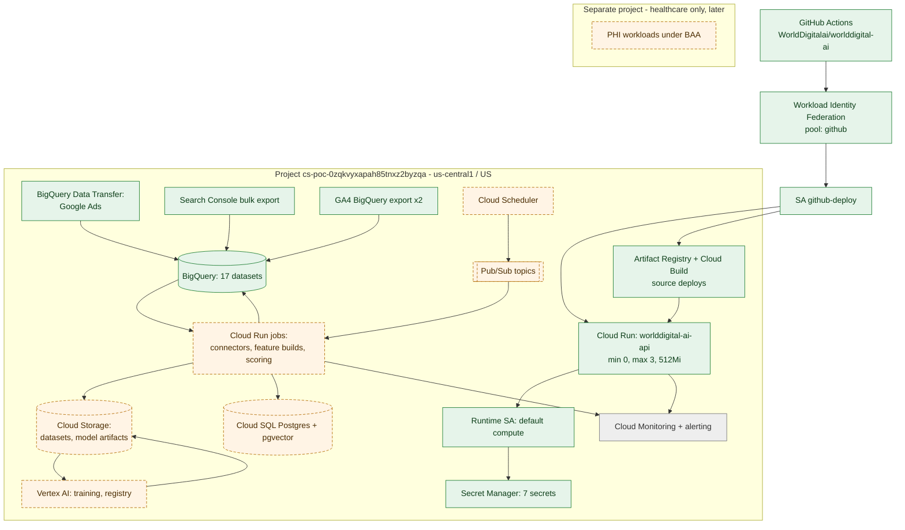

# WorldDigital Google Cloud Architecture

**Purpose.** The current Google Cloud setup, and how each service should be used as the Intelligence Engine grows.
**Scope.** Projects, IAM, compute, data, AI and networking on Google Cloud.
**Dependencies.** [Deployment Architecture](WORLDDIGITAL_DEPLOYMENT_ARCHITECTURE.md), [Security](../security/WORLDDIGITAL_SECURITY_ARCHITECTURE.md), [Cost Analysis](../financial-planning/WORLDDIGITAL_COST_ANALYSIS.md).
**Status.** Per component. This session could read BigQuery metadata but **could not reach the Cloud Run, Pub/Sub, Scheduler, Cloud SQL, Storage, Vertex AI or Secret Manager admin APIs**. Those rows are verified from deploy configuration only, or marked NEEDS VERIFICATION.

## Diagram 5: Google Cloud infrastructure

<!-- MERMAID:WORLDDIGITAL_GOOGLE_CLOUD_INFRASTRUCTURE.mmd -->

<!-- /MERMAID -->

**How it connects.** GitHub Actions signs in through Workload Identity Federation (pool `github`, restricted to `WorldDigitalai/worlddigital-ai`) as `github-deploy`, which builds from source with Cloud Build into Artifact Registry and deploys Cloud Run. Cloud Run runs as the default compute service account and reads Secret Manager. Google's export services write to BigQuery. The proposed scheduler → Pub/Sub → Cloud Run jobs chain feeds BigQuery, Cloud Storage and Cloud SQL. Vertex AI reads training snapshots from and writes artifacts to Cloud Storage.

## Service-by-service

| Service | Current use | Status | Recommended use |
|---|---|---|---|
| Project `cs-poc-0zqkvyxapah85tnxz2byzqa` | Everything | EXISTING | Create `worlddigital-prod` and `worlddigital-dev` (and later `worlddigital-phi`) under an Organization; move workloads in Phase 1–2 (AD-9) |
| Cloud Run | `worlddigital-ai-api` | EXISTING (config) | API + Intelligence API services; **Cloud Run jobs** for connectors, Dataform triggers, scoring |
| Cloud Build / Artifact Registry | Source deploys | EXISTING (config) | Keep; add vulnerability scanning |
| Secret Manager | 7 secrets | EXISTING (config) | All secrets, including the two now passed as env vars; per-tenant OAuth tokens (or KMS-encrypted columns in Postgres) |
| Workload Identity Federation | GitHub → Google | EXISTING (config) | Add the `worlddigital-us` repo if it ever needs GCP; split deploy and read-only identities |
| BigQuery | Warehouse | EXISTING (verified) | Analytics + BigQuery ML; row-level security per tenant |
| BigQuery Data Transfer | Google Ads 442-763-5466 | EXISTING (verified) | Use for WorldDigital's own account; tenants use API connectors (DTS per tenant is also possible for Google Ads) |
| Search Console / GA4 exports | Both sites | EXISTING (verified) | Keep; drop the duplicate `_prefix` export |
| Cloud Scheduler | – | PROPOSED | Daily ingestion and pipeline triggers |
| Pub/Sub | – | PROPOSED | Decouple connector requests from loaders; dead-letter topic |
| Cloud SQL (Postgres) | – | PROPOSED | Tenancy, users, approvals, `pgvector`; start on the smallest shared-core tier, with HA when the first paying tenants arrive |
| Cloud Storage | – | NEEDS VERIFICATION (the deploy SA has `storage.admin`; Cloud Build uses a bucket) | Training snapshots, model artifacts, creatives, under `tenant_id/` prefixes with lifecycle rules |
| Vertex AI | – | PROPOSED | Custom training jobs + Model Registry when BQML is beaten; Gemini models through the LLM gateway; **no always-on endpoints initially** |
| Vector search | – | PROPOSED | `pgvector` first; BigQuery `VECTOR_SEARCH` for warehouse-side; Vertex Vector Search only at large scale |
| Cloud Monitoring / Logging | Unknown | NEEDS VERIFICATION | Uptime checks on the API, error-rate alerts, budget alerts |
| Billing budgets | Unknown | NEEDS VERIFICATION | Monthly budget with 50/90/100% alerts per project |

## Scalability, reliability, DR, security improvements (priority order)
1. Billing budget alerts (minutes to set up; protects against runaway cost).
2. Move the two plain env-var secrets into Secret Manager.
3. Split `github-deploy` into a deploy identity and a read-only identity (the weekly site audit only needs `bigquery.jobUser` + `bigquery.dataViewer`).
4. Separate dev and prod projects before customer data.
5. Uptime checks + alerting on `/api/tools/health`.
6. Cloud SQL with automated backups + point-in-time recovery (when created).
7. MongoDB Atlas: replace a `0.0.0.0/0` network rule (if present; **NEEDS VERIFICATION**) with Cloud NAT static egress + an Atlas IP allowlist.

## Region
`us-central1` for compute, US multi-region for BigQuery. Keep new resources in the same pair to avoid egress charges. Canadian customers: data stays in the US unless a contract requires Canadian residency (then `northamerica-northeast1`).

## Related
[Master](../WORLDDIGITAL_MASTER_ARCHITECTURE.md) · [Technology Stack](../architecture/WORLDDIGITAL_TECHNOLOGY_STACK.md)
