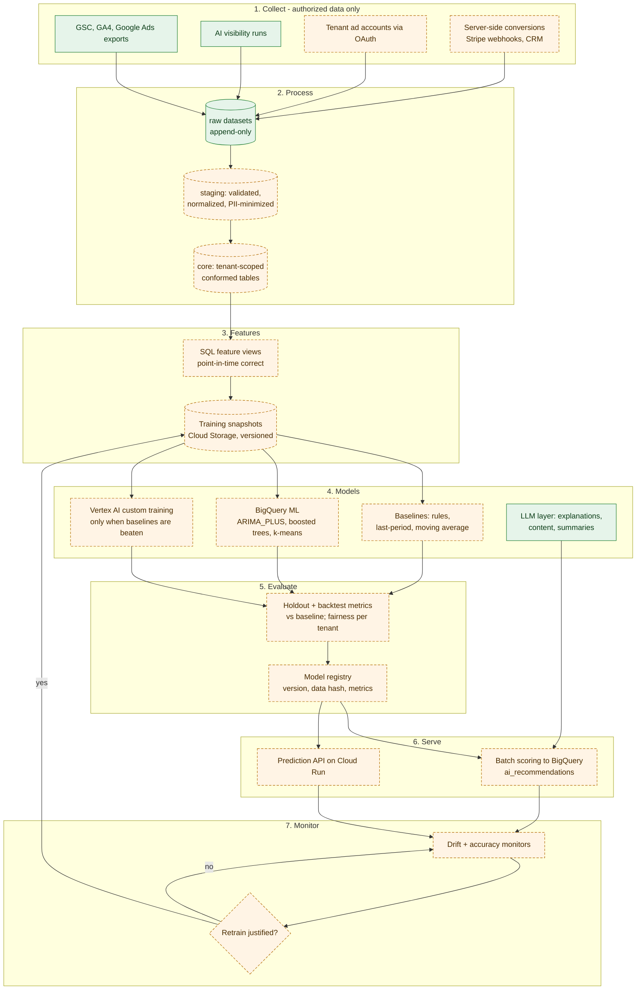

# WorldDigital Machine Learning Architecture

**Purpose.** The end-to-end ML lifecycle: data, features, training, evaluation, deployment, monitoring and retraining.
**Scope.** All ML models in the Intelligence Engine.
**Dependencies.** [Data Architecture](../data-infrastructure/WORLDDIGITAL_DATA_ARCHITECTURE.md), [Feature Engineering](../data-infrastructure/WORLDDIGITAL_FEATURE_ENGINEERING.md), [Model Development](WORLDDIGITAL_ML_MODEL_DEVELOPMENT.md).
**Status.** No models exist (PROPOSED). Source data feeds EXISTING.

## Diagram 2: AI and ML lifecycle

<!-- MERMAID:WORLDDIGITAL_AI_ML_ARCHITECTURE.mmd -->

<!-- /MERMAID -->

| Stage | Component | What it does | Where |
|---|---|---|---|
| 1 Collect | Managed exports, AI-visibility runs, tenant connectors, server-side conversions | Bring in only authorized data | BigQuery `*_raw` |
| 2 Process | raw → staging → core | Validate types and ranges, deduplicate, normalize currencies and time zones, drop or hash PII, attach `tenant_id` | Dataform SQL |
| 3 Features | Feature views + snapshots | Point-in-time features (no leakage), saved as dated snapshots | BigQuery views → Cloud Storage Parquet |
| 4 Models | Baselines, BigQuery ML, Vertex custom | Baselines are mandatory; BigQuery ML is the default; Vertex only when justified | BigQuery / Vertex |
| 5 Evaluate | Backtests, holdouts, per-tenant breakdown | Ship only if the model beats the baseline by a set margin on held-out data | SQL + Python notebooks |
| 6 Serve | Batch scoring (default), Prediction API (when latency matters) | Write predictions to `ml_predictions` / `ai_recommendations` | BigQuery `ML.PREDICT` / Cloud Run |
| 7 Monitor | Drift + realized accuracy | Compare predictions with outcomes; alert on drift | Scheduled SQL + Cloud Monitoring |

## Design rules
1. **Batch first.** Marketing decisions are daily, not millisecond. Batch scoring in BigQuery needs no servers.
2. **Per-tenant models by default.** Pooled models need consent ([Isolation](../security/WORLDDIGITAL_CUSTOMER_DATA_ISOLATION.md#model-isolation)).
3. **Every model has a model card:** purpose, data, features, metric, baseline, owner, retrain trigger, known limits.
4. **Reproducible:** data snapshot hash + SQL/code commit + hyperparameters in the registry.
5. **Classical before deep learning.** See [Deep Learning Architecture](../deep-learning/WORLDDIGITAL_DEEP_LEARNING_ARCHITECTURE.md).

## Monitoring and retraining
- **Data drift:** population stability index per feature weekly; alert if PSI > 0.2.
- **Performance:** realized MAPE or AUC on the last 28 days vs the model card.
- **Retrain when** performance drops below the baseline + margin, drift persists 2 weeks, or there is a schema or business change. Not on a fixed timer by default.

## Related
[Predictive Analytics](WORLDDIGITAL_PREDICTIVE_ANALYTICS.md) · [Recommendation Engine](WORLDDIGITAL_RECOMMENDATION_ENGINE.md) · [Testing](../testing/WORLDDIGITAL_TESTING_STRATEGY.md)
