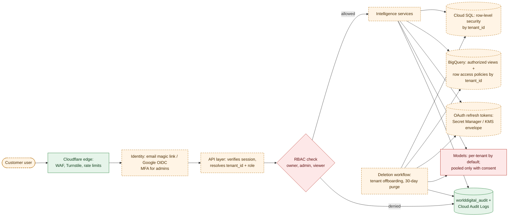

# WorldDigital Customer Data Isolation

**Purpose.** How each customer business's data stays separate in storage, processing, models and deletion.
**Scope.** The multi-tenant Intelligence Engine.
**Dependencies.** [Security](WORLDDIGITAL_SECURITY_ARCHITECTURE.md), [Data Architecture](../data-infrastructure/WORLDDIGITAL_DATA_ARCHITECTURE.md).
**Status.** PROPOSED. The `tenant_id` columns already exist in `worlddigital_core`, `worlddigital_ai`, `worlddigital_audit` and `worlddigital_raw` (IN PROGRESS).

## Diagram 6: Customer data and security

<!-- MERMAID:WORLDDIGITAL_CUSTOMER_DATA_SECURITY.mmd -->

<!-- /MERMAID -->

**How it flows.** A customer user passes the Cloudflare edge (WAF, Turnstile, rate limits), signs in, and the API layer resolves `tenant_id` and role from the session, never from request input. An RBAC check allows or denies, and denials are logged. Services read and write Postgres under row-level security and BigQuery through authorized views and row access policies. OAuth tokens are fetched from encrypted storage. Models are per-tenant unless the tenant consented to pooling. Every access and action is audited. The deletion workflow purges every store and records the deletion.

## Model
- **Tenant** = a customer account (agency or business). **Business** = a brand or location under a tenant. Both ids are on every row.
- **Roles:** `owner` (billing, connections, approvals), `admin` (approvals), `analyst` (read + recommendations), `viewer` (read).
- WorldDigital staff access a tenant only through a time-boxed "support session" that the tenant can see in its audit log.

## Isolation by layer
| Layer | Mechanism |
|---|---|
| Postgres | Row-level security policies on `tenant_id = current_setting('app.tenant_id')`; app role without `BYPASSRLS` |
| BigQuery | Shared tables clustered by `tenant_id` + row access policies; the API queries through one data-access module that injects the tenant filter; tests prove cross-tenant reads return zero rows |
| Cloud Storage | `gs://<bucket>/tenant_id/…`; signed URLs only; no public objects |
| Secrets | One token record per (tenant, platform, account), encrypted with a KMS key |
| Caches | Cache keys prefixed with `tenant_id` |
| Logs | No C3/C4 data in logs; `tenant_id` included for tracing |
| LLM calls | Only that tenant's context; prompts and outputs are not used for provider training (enterprise or API terms) |

**When to use dataset-per-tenant instead:** enterprise contracts that require physical separation or a customer-managed key. Offer it as an enterprise tier (one dataset or project per tenant).

## Model isolation
Default: models are trained per tenant (or are unsupervised and per tenant). Pooled models need (1) a contract opt-in, (2) aggregated features only, no C3, (3) k-anonymity ≥ 20 tenants for any shared statistic shown back, and (4) removal from the next snapshot on opt-out. Benchmarks such as "your CTR vs similar businesses" use the same rules.

## Testing isolation
Automated tests create two tenants and assert that every API endpoint and every BigQuery access path returns only the caller's rows. These run in CI and nightly against staging.

## Related
[Data Governance](../data-infrastructure/WORLDDIGITAL_DATA_GOVERNANCE.md) · [Testing](../testing/WORLDDIGITAL_TESTING_STRATEGY.md)
